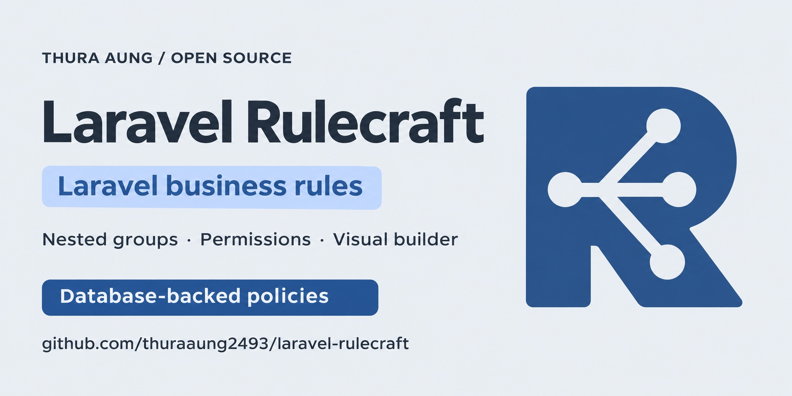

<p align="center">
  
</p>

# Rulecraft

Rulecraft is a Laravel developer tool for business rules and conditional role permissions. Store conditions in the database, combine them with AND/OR groups, and evaluate application data. Execute registered actions explicitly when a policy passes.

It uses Symfony Expression Language and configurable table names. The source targets PHP 7.3 compatibility and Laravel 7–13 on compatible runtimes. The first beta is `v0.1.0-beta.1`; the development version is `dev-main`, tracked by the `main` branch.



An open-source project by [Thura Aung](https://thuraaung2493.github.io/).

## Features

- Database-backed rules and nested ALL/ANY groups, including groups with only children.
- Symfony expressions with comparisons, list membership, nested context, and custom functions.
- Structured decisions, custom per-rule success/failure messages, errors, and optional fail-fast evaluation.
- Optional Laravel validation rules for context data.
- Enabled/disabled states for groups and individual rules.
- Ordered actions with configurable or provider-based registration and structured outcomes.
- Conditional role permissions through optional Spatie Laravel Permission integration.
- Blade conditions for group decisions and conditional permissions.
- CLI policy testing without action execution.
- Versioned JSON import/export through strings or files, with clipboard-friendly output.
- Completed group/permission evaluation events for application listeners.
- Embeddable Blade rule builder with visual/code modes, draft previews, and custom/Bootstrap presets.
- Independent configuration of every package table name.

The builder is optional and disabled by default. See [builder examples](docs/examples/builder.md) for complete setup and CSS customization.

## Getting started

The sections below introduce the core workflow in one place. Create policy records once, for example in a seeder; evaluate them in application requests. Each section links to optional details.

- [Install and migrate](#install-and-migrate)
- [Create rules and evaluate](#create-rules-and-evaluate)
- [Customize rule messages](#customize-rule-messages)
- [Combine nested groups](#combine-nested-groups)
- [Run actions](#run-actions)
- [Check conditional permissions](#check-conditional-permissions)
- [Use Blade conditions](#use-blade-conditions)
- [Validate context](#validate-context)
- [Enable or disable conditions](#enable-or-disable-conditions)
- [Test from the terminal](#test-from-the-terminal)
- [Import and export JSON](#import-and-export-json)
- [Observe evaluation events](#observe-evaluation-events)
- [Embed the visual builder](#embed-the-visual-builder)

### Install and migrate

Install the beta from Packagist:

```bash
composer require thuraaung2493/laravel-rulecraft:0.1.0-beta.1
php artisan vendor:publish --tag=rulecraft-config
```

The publishing workflow and first-time setup are described in [Publishing](docs/publishing.md).
For a local checkout before Packagist registration, add a path repository to your Laravel application's `composer.json`:

```json
{
    "repositories": [
        { "type": "path", "url": "/absolute/path/to/laravel-rulecraft" }
    ]
}
```

Require the local development version and publish configuration:

```bash
composer require thuraaung2493/laravel-rulecraft:dev-main
php artisan vendor:publish --tag=rulecraft-config
```

Before the first migration, optionally change table names in `config/rulecraft.php`:

```php
'tables' => [
    'rules' => 'business_conditions',
    'rule_groups' => 'lending_policies',
    'role_permission_rules' => 'conditional_grants',
],
```

Keep the defaults if they suit your application, then create the schema:

```bash
php artisan migrate
```

Laravel discovers the provider and loads the initial migration automatically. Each Laravel major requires a compatible PHP runtime; PHP 7.3 is not sufficient for modern Laravel versions. See [configuration](docs/configuration.md) for all settings and [development](docs/development.md) for compatibility verification.

### Create rules and evaluate

This policy requires a matching branch AND an amount within the limit:

```php
use Thuraaung\Rulecraft\Facades\Rulecraft;
use Thuraaung\Rulecraft\Models\RuleGroup;

$group = RuleGroup::create(['name' => 'small-loan', 'match' => 'all']);
$group->rules()->createMany([
    ['name' => 'same-branch', 'expression' => 'loan_branch_id == user_branch_id'],
    ['name' => 'within-limit', 'expression' => 'loan_amount <= approval_limit'],
]);

$data = [
    'loan_id' => 42,
    'loan_branch_id' => 1,
    'user_branch_id' => 1,
    'loan_amount' => 100000,
    'approval_limit' => 200000,
    'special_approval' => false,
];

$result = Rulecraft::group('small-loan')->evaluate($data);
$result->passed(); // true
$result->failed(); // false
$result->hasErrors(); // false
```

`all` means AND; `any` means OR. Empty groups fail. Context keys become variables: omit `$`, quote string literals, and use `==` or `===` for equality. For example, `zone_type == "Green"` and `product_id in [2, 5, 8]` are valid expressions. Group names are globally unique.

Results are objects: check `passed()` explicitly. A different branch produces an ordinary denial with no error; a missing variable or invalid expression records an error and fails the selected group. `failedRules()` returns rule results with `rule()` and `error()`. A missing group throws `RuleGroupNotFoundException`.

Details: [expression syntax](docs/expressions.md), [complete rule examples](docs/examples/rules.md), and [result methods](docs/api-reference.md#evaluationresult).

### Customize rule messages

Set an optional message when creating or updating a rule:

```php
$group->rules()->where('name', 'within-limit')->update([
    'failure_message' => 'The loan amount exceeds your approval limit.',
    'success_message' => 'The loan amount is within your approval limit.',
]);

$result = Rulecraft::group('small-loan')->evaluate(array_replace($data, [
    'loan_amount' => 300000,
]));

$result->failedMessage();
// 'The loan amount exceeds your approval limit.'

$result = Rulecraft::group('small-loan')->evaluate($data);
$result->passedMessage();
// 'The loan amount is within your approval limit.'
```

Both helpers return strings and join messages with a space; pass a custom separator such as `failedMessage(' • ')`. `passedMessage()` includes configured success text from successful branches only. No success text means an empty string. Ordinary false conditions retain a rule-name fallback; disabled/error rules contribute no message. Each rule result exposes its own outcome text through `message()`. The Builder exposes both optional fields in its collapsible Messages panel. See [message behavior and examples](docs/examples/rules.md#rule-messages).

### Combine nested groups

Create a separate policy for `same branch AND (within limit OR special approval)`:

```php
$root = RuleGroup::create(['name' => 'loan-approval', 'match' => 'all']);
$root->rules()->create([
    'name' => 'same-branch',
    'expression' => 'loan_branch_id == user_branch_id',
]);
$alternatives = $root->groups()->create(['name' => 'limit-or-special', 'match' => 'any']);
$alternatives->rules()->createMany([
    ['name' => 'limit', 'expression' => 'loan_amount <= approval_limit'],
    ['name' => 'special', 'expression' => 'special_approval == true'],
]);

$result = Rulecraft::group('loan-approval')->evaluate(array_replace($data, [
    'loan_amount' => 300000,
    'special_approval' => true,
]));
$result->passed(); // true: branches match and special approval passes
$result->groups()->get('limit-or-special')->passed(); // true
```

A group can contain rules, child groups, or both. Selecting a child by name checks that subtree's conditions; select the root to enforce the complete policy. Disabled ancestors still block a child selection. An ALL selection supports `->stopOnFailure()->evaluate($data)`.

Details: [nested results and traversal](docs/examples/rules.md#nested-loan-approval).

### Run actions

`evaluate()` checks conditions. `run()` evaluates first, then executes eligible handlers if the selected policy passes. Create the [sample RecordLoanDecision handler](docs/examples/actions.md#a-complete-handler), then register it in your application's service provider `boot()` method:

```php
use App\Actions\RecordLoanDecision;
use Thuraaung\Rulecraft\Facades\Rulecraft;

Rulecraft::registerAction('record_loan_decision', RecordLoanDecision::class);
```

Attach it to the existing `small-loan` rule and run the policy with the original `$data`:

```php
$rule = $group->rules()->where('name', 'within-limit')->firstOrFail();
$rule->update([
    'action' => 'record_loan_decision',
    'action_parameters' => ['decision' => 'approved'],
]);

$execution = Rulecraft::group('small-loan')->run($data);
$execution->successful(); // true, with the sample handler registered
$execution->actions()->count(); // 1
$execution->context()['decision_recorded']; // true
```

A handler implements `Contracts\Action` and returns `ActionResult`. Several eligible rules can invoke several actions. The first handler failure stops the chain; successful outputs remain in the returned context. Repeated `run()` calls are separate executions.

Details: [complete handler, ordering, and failure examples](docs/examples/actions.md); [registration options](docs/configuration.md#actions).

### Check conditional permissions

For an application with Spatie Laravel Permission installed and its `HasRoles` user model configured, map an actual role-permission grant to the existing root policy:

```php
use App\Models\User; // Use your application's User namespace.
use Spatie\Permission\Models\Permission;
use Spatie\Permission\Models\Role;
use Thuraaung\Rulecraft\Models\RolePermissionRule;

$user = User::findOrFail(1); // An existing application user.
$role = Role::findOrCreate('Branch Manager', 'web');
$permission = Permission::findOrCreate('Loan Approval', 'web');
$role->givePermissionTo($permission);
$user->assignRole($role);
RolePermissionRule::assign($role, $permission, $group);

$decision = Rulecraft::for($user)->permission('Loan Approval')->guard('web')->evaluate($data);
$decision->passed(); // true: the actual grant and mapped policy both pass
```

The mapping alone does not grant permission. At least one complete actual grant and its mapped root must pass. Permission checks never execute actions or automatically replace Laravel Gate/Spatie `can()`. Use trusted, server-derived authorization context.

Details: [Spatie setup, guards, teams, and permission outcomes](docs/examples/permissions.md).

### Use Blade conditions

Pass the same context to your view as `$data`:

```blade
@rulecraft('small-loan', $data)
    <p>The loan meets the business conditions.</p>
@endrulecraft

@canRulecraft('Loan Approval', $data)
    <button type="submit">Approve loan</button>
@else
    <p>You cannot approve this loan.</p>
@endcanRulecraft
```

Both use evaluation only. `@canRulecraft` checks the authenticated user; guests receive `false`. Enforce the decision in the controller or service as well.

Details: [group conditions](docs/examples/rules.md#show-a-group-decision-in-blade) and [permission conditions](docs/examples/permissions.md#show-a-conditional-permission-in-blade).

### Validate context

Optionally declare Laravel validation rules in `config/rulecraft.php`:

```php
'context_rules' => [
    'small-loan' => ['loan_amount' => ['required', 'numeric']],
],
```

Invalid data fails before that group's expressions run:

```php
$result = Rulecraft::group('small-loan')->evaluate(array_replace($data, [
    'loan_amount' => 'invalid',
]));
$result->passed(); // false
$result->hasErrors(); // true
$result->validationErrors(); // ['loan_amount' => [...field messages...]]
```

Validation reports errors without casting the supplied values. Rebuild Laravel's config cache if used.

Details: [context configuration](docs/configuration.md#context-validation) and [nested validation examples](docs/examples/policy-management.md#validate-context).

### Enable or disable conditions

Groups and rules default to enabled. To suspend the saved policy:

```php
$group->update(['enabled' => false]);
$result = Rulecraft::group('small-loan')->evaluate([]);
$result->passed(); // false
$result->disabled(); // true
$group->update(['enabled' => true]); // Restore it for later checks.
```

Individual rules support the same attribute. Disabled nodes count as non-passing; disabled groups skip their subtree. An ALL group therefore cannot bypass a disabled requirement.

Details: [ALL/ANY state behavior and result snapshots](docs/examples/policy-management.md#enable-or-disable-policies).

### Test from the terminal

Inspect a saved policy without running its actions:

```bash
php artisan rulecraft:test small-loan --data='{
    "loan_branch_id": 1,
    "user_branch_id": 1,
    "loan_amount": 100000,
    "approval_limit": 200000
}'
```

This prints the decision tree. Exit codes are `0` for pass, `1` for denial, and `2` for invalid input or evaluation errors. `--data` accepts a JSON object string.

Details: [sample output and CLI errors](docs/examples/policy-management.md#test-a-saved-policy-from-the-terminal).

### Import and export JSON

Use JSON strings directly, including clipboard piping on macOS:

```bash
php artisan rulecraft:export small-loan | pbcopy
# In a destination without these group names:
php artisan rulecraft:import --json="$(pbpaste)"
```

Or choose your own local file path:

```bash
mkdir -p policies
php artisan rulecraft:export small-loan --output=policies/small-loan.json
# In a destination without these group names:
php artisan rulecraft:import --file=policies/small-loan.json
```

The PHP API is `Rulecraft::export($name): string` and `Rulecraft::import($json): RuleGroup`. Imports validate the complete tree and save it transactionally. Existing group names are rejected. File export requires an existing parent directory and a new output path. Transfer preserves conditions, states, priorities, and action names/parameters; application code, config, and permission mappings stay application-managed.

Details: [JSON schema, storage paths, and transfer behavior](docs/examples/policy-management.md#import-and-export-policies).

### Observe evaluation events

Register a listener in your application provider's `boot()` method:

```php
use Illuminate\Support\Facades\Event;
use Thuraaung\Rulecraft\Events\GroupEvaluated;

Event::listen(GroupEvaluated::class, function (GroupEvaluated $event): void {
    logger()->info('Rulecraft decision', [
        'group' => $event->group,
        'passed' => $event->result->passed(),
    ]);
});
```

Each completed group selection emits once, including denied or error results. `PermissionEvaluated` carries the final permission decision after its mapped group events. During `run()`, the group event fires before handlers are resolved or executed. Listeners use Laravel's normal event handling; the application owns auditing and metrics storage.

Details: [complete listener examples and timing](docs/examples/events.md) and [event payload reference](docs/api-reference.md#evaluation-events).

### Embed the visual builder

Enable `builder` in `config/rulecraft.php`. Context fields can be entered freely:

```php
'builder' => [
    'enabled' => true,
    'theme' => 'custom', // custom or bootstrap
    'stylesheet' => 'css/rulecraft-overrides.css', // Optional application stylesheet.
    'fields' => [], // Optional catalog for dropdowns and friendly labels.
],
```

Authorize management access in an application provider's `boot()` method:

```php
use Illuminate\Support\Facades\Gate;

Gate::define('manage-rulecraft', function ($user): bool {
    return (bool) $user->is_admin; // Replace with your application's access check.
});
```

Embed it inside your authenticated application's Blade page:

```blade
<x-rulecraft::builder group="loan-approval" />
```

Omit `group` to create a policy, or pass a name dynamically with `:group="$groupName"`. Existing expression rules open without being rewritten. Visible Rule details contains Name, Priority, and Editor, followed by Source, Operator, and Compare with rows. Field types stay beside their source, literal types beside comparison values, and optional action details in a separate collapsible Action section. Operators show labels such as Equals (==). Preview evaluates draft conditions without saving records or running handlers. Saving preserves existing IDs and mappings. The component includes its bundled assets once per page; applications need no frontend build step.

Choose the custom or scoped Bootstrap 5.3.8 preset. Your stylesheet loads last, supporting variables such as `--rc-primary`, `--rc-radius`, and `--rc-font-family` under `.rulecraft-builder`.

Custom functions can expose a typed signature through the optional [builder provider interface](docs/examples/builder.md#custom-expression-providers), such as `credit_score(int applicant_id): int`. Arguments bind automatically to matching context keys. Register each provider once in `expression_providers`; ordinary fields need no registration. Custom functions work on either side of a visual comparison, including function-to-function checks.

Details: [component usage, editing, CSS overrides, and view publishing](docs/examples/builder.md); [all builder settings](docs/configuration.md#builder).

## Documentation

| Need | Page |
| --- | --- |
| Methods, return values, and exceptions | [API reference](docs/api-reference.md) |
| Valid expression syntax and custom functions | [Expression reference](docs/expressions.md) |
| All configuration keys, defaults, and registration options | [Configuration](docs/configuration.md) |
| Complete business scenarios, handlers, and operational examples | [Use cases and examples](docs/examples.md) |
| Tests, tooling, and runtime verification | [Development](docs/development.md) |
| Development versions and Packagist publishing | [Publishing](docs/publishing.md) |
